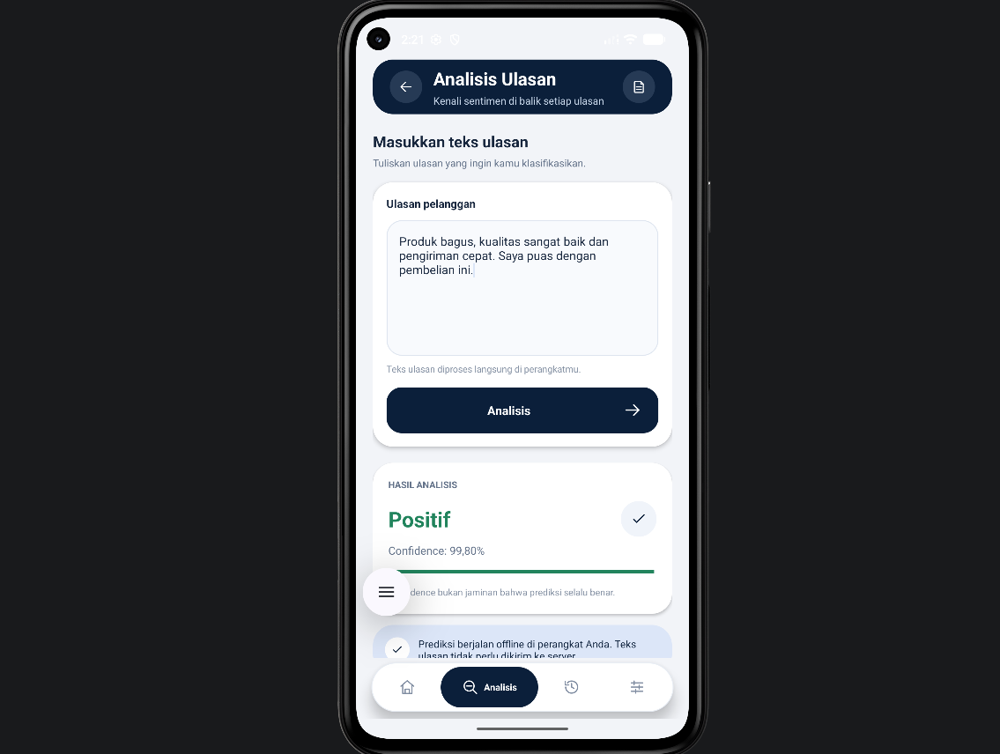
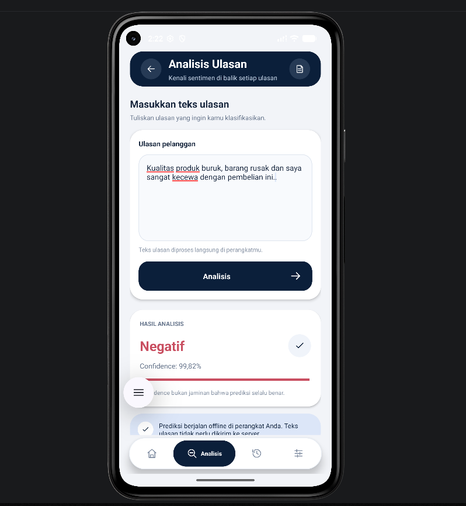

# Customer Review Classification

An Android application for classifying Indonesian customer reviews into positive and negative sentiment using IndoBERT and ONNX Runtime.

The application performs model inference locally on the Android device after the application and model have been installed. No FastAPI prediction API is required for sentiment inference.

## Features

- Classifies customer reviews into positive or negative sentiment.
- Displays the predicted sentiment and confidence score.
- Uses an IndoBERT model exported to ONNX and quantized to INT8.
- Runs sentiment inference locally on the Android device.
- Displays prediction results through the application's analysis feature.

## Application Screenshots

### Positive Sentiment Prediction



### Negative Sentiment Prediction



## Technology Stack

- Kotlin and Android SDK
- Android Studio
- Gradle Kotlin DSL
- IndoBERT
- ONNX Runtime for Android
- Git LFS for large model files

## Project Structure

```text
CustomerReviewClassifier/
+-- android/
¦   +-- app/
¦   ¦   +-- src/main/
¦   ¦       +-- assets/
¦   ¦       ¦   +-- model.onnx
¦   ¦       ¦   +-- config.json
¦   ¦       ¦   +-- deployment_info.json
¦   ¦       ¦   +-- labels.json
¦   ¦       ¦   +-- tokenizer.json
¦   ¦       ¦   +-- tokenizer_config.json
¦   ¦       ¦   +-- special_tokens_map.json
¦   ¦       ¦   +-- vocab.txt
¦   ¦       +-- java/com/trio/customerreview/
¦   ¦           +-- MainActivity.kt
¦   ¦           +-- OnnxPredictor.kt
¦   ¦           +-- TextTokenizer.kt
¦   +-- gradle/
¦   ¦   +-- libs.versions.toml
¦   +-- build.gradle.kts
¦   +-- settings.gradle.kts
+-- docs/
¦   +-- demo-scenario.md
¦   +-- screenshots/
¦       +-- 02-positive-prediction.png
¦       +-- 03-negative-prediction.png
+-- ml_training/
¦   +-- notebooks/
¦   ¦   +-- customer_review_classification_ml_pipeline.ipynb
¦   +-- README.md
+-- .gitattributes
+-- .gitignore
+-- README.md
```

## Machine Learning Pipeline

The training notebook documents the following workflow:

1. Exploratory Data Analysis (EDA).
2. Baseline text classification using TF-IDF and Logistic Regression.
3. Fine-tuning `indobenchmark/indobert-base-p1`.
4. Model evaluation using classification metrics.
5. Exporting the model to ONNX and quantizing it to INT8.
6. Preparing the model and tokenizer for Android deployment.

### Dataset

The training workflow uses `labeledReview.datasetFix.json`, a labeled customer review dataset.

The EDA notebook reports 11,606 rows. For details about dataset preparation, preprocessing, training, and evaluation, see the ML training notebook and [`ml_training/README.md`](ml_training/README.md).

### Sentiment Labels

| Label | Sentiment |
| --- | --- |
| 0 | Negative |
| 1 | Positive |

### ONNX INT8 Evaluation Results

The deployed model's `deployment_info.json` records the following evaluation metrics:

| Metric | Result |
| --- | ---: |
| Accuracy | 93.36% |
| Precision | 94.20% |
| Recall | 92.41% |
| F1-score | 93.30% |

The evaluation used 1,160 test samples: 580 negative reviews and 580 positive reviews.

These metrics describe the model's reported performance on the test dataset. They do not guarantee that every individual prediction made by the application will be correct.

For further experiment details, see [`ml_training/notebooks/customer_review_classification_ml_pipeline.ipynb`](ml_training/notebooks/customer_review_classification_ml_pipeline.ipynb).

### Deployed Model Details

The following information is recorded in `android/app/src/main/assets/deployment_info.json` and the Gradle version catalog.

| Property | Value |
| --- | --- |
| Model name | IndoBERT Customer Review Sentiment |
| Base model | `indobenchmark/indobert-base-p1` |
| Model format | ONNX |
| Quantization | Dynamic INT8 Quantization |
| Model file | `model.onnx` |
| Model size | 119.83 MiB (125,654,812 bytes) |
| Maximum sequence length | 128 tokens |
| Number of labels | 2 |
| ONNX Runtime Android | `1.30.0` |

Label mapping:

- `0`: NEGATIF
- `1`: POSITIF

The model and tokenizer files are bundled in the Android application's assets. `TextTokenizer.kt` prepares review text, and `OnnxPredictor.kt` runs inference through an ONNX Runtime session.

The inference result is used by the application's analysis interface to display sentiment and confidence.## Android Application

### Requirements

- Android Studio
- Android SDK compatible with the project configuration
- Git
- Git LFS for downloading the model files

### Clone the Repository

```bash
git clone https://github.com/Central-Saga/Trio-Project3-ML-CustomerReviewClassifier.git
cd Trio-Project3-ML-CustomerReviewClassifier
git lfs install
git lfs pull
```

Git LFS must be installed to retrieve the large model files tracked by Git LFS. Make sure the model files are downloaded before running the application.

### Run Using Android Studio

1. Open Android Studio.
2. Select **Open** and choose the repository's `android/` directory.
3. Wait for Gradle Sync to finish.
4. Start an Android emulator or connect a compatible Android device.
5. Select the `app` run configuration.
6. Click **Run**.

### Build Using PowerShell

From the repository root, enter the Android project directory:

```powershell
Set-Location android
.\gradlew.bat assembleDebug
```

To install the debug build on a connected device or running emulator:

```powershell
.\gradlew.bat installDebug
```

The debug APK is normally generated at:

```text
android/app/build/outputs/apk/debug/app-debug.apk
```

### How Inference Works

```text
Customer Review
      |
      v
TextTokenizer.kt
      |
      v
input_ids, attention_mask, token_type_ids
      |
      v
OnnxPredictor.kt
      |
      v
ONNX INT8 Model
      |
      v
Positive / Negative Sentiment
      |
      v
Prediction Result and Confidence
      |
      v
Analysis UI and Prediction History
```

The application prepares the review text using the tokenizer and runs inference with ONNX Runtime. The resulting sentiment and confidence are used by the analysis interface.

Sentiment prediction runs locally on the Android device and does not require FastAPI.

## Git LFS

The ONNX model is stored using Git LFS because of its file size.

After cloning the repository, run:

```bash
git lfs install
git lfs pull
```

Verify that `android/app/src/main/assets/model.onnx` contains the actual model file rather than a Git LFS pointer before building or running the application.

## Demo Scenario

See [`docs/demo-scenario.md`](docs/demo-scenario.md) for the demonstration flow, example reviews, machine learning overview, and demo checklist.

## Repository

[Central-Saga/Trio-Project3-ML-CustomerReviewClassifier](https://github.com/Central-Saga/Trio-Project3-ML-CustomerReviewClassifier)